Case for a split 40% Alice keyboard, designed with [alice-layout-designer](https://github.com/Noah-Mav/alice-layout-designer.git)

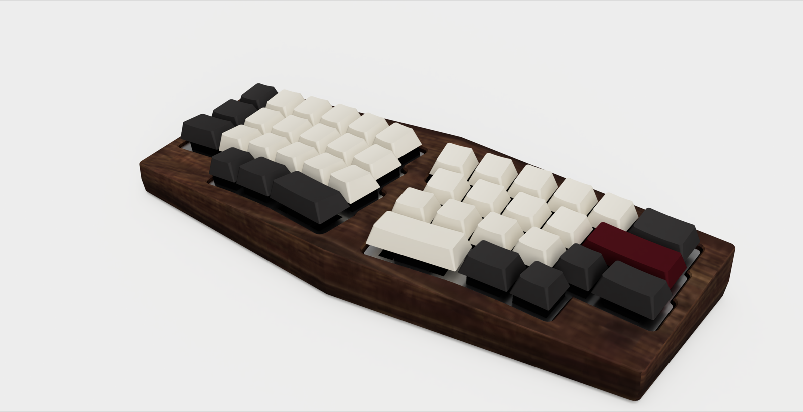

| Top | Back | Underside | Low |
|---|---|---|---|
| 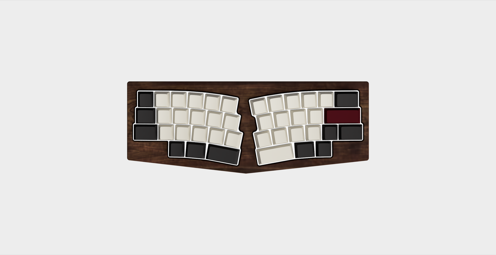 | 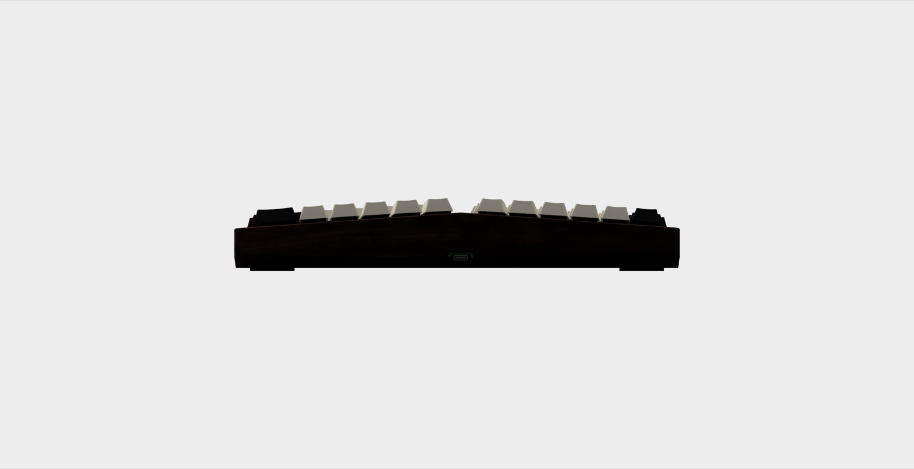 | 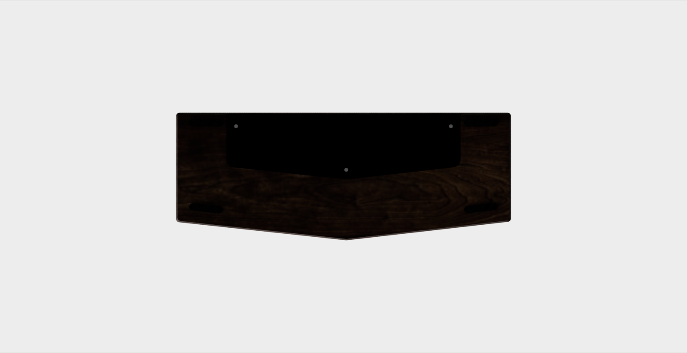 | 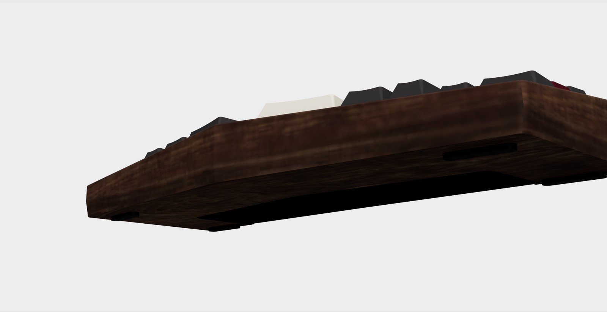 |

Renders from Fusion (walnut body, anodised panel, Cherry-profile caps). Electronics are placeholders.

The layout designer is included as the `layout/` submodule (`layout/alice.py` supplies the key positions). The saved layout is `layouts/layout2.json`.

## Design progress

v1 (left) and v2 (right), same camera, body and panel only.

| View | v1 and v2 |
|---|---|
| Top | 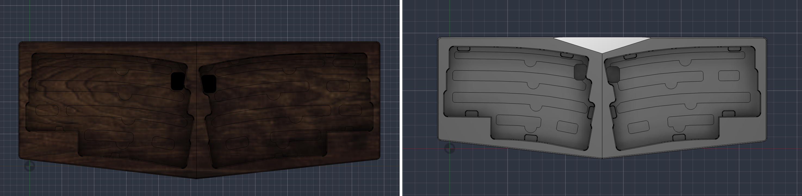 |
| Side | 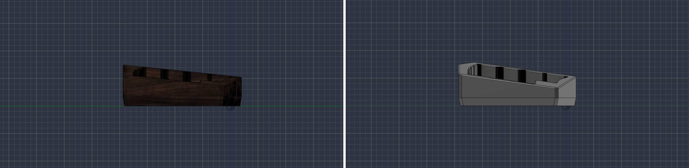 |
| Rear | 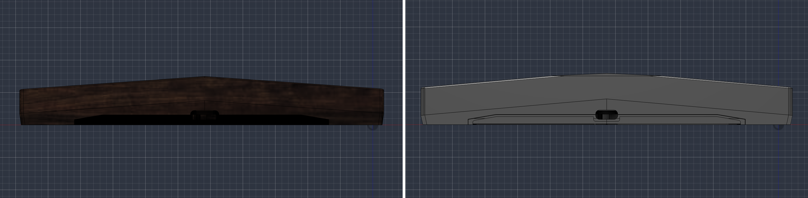 |
| Underside | 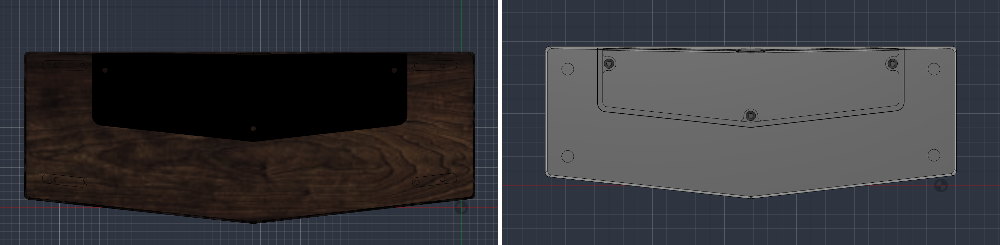 |
| Iso | 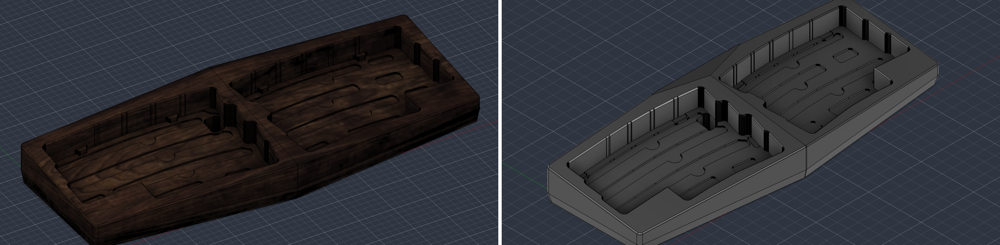 |

| | v1 | v2 |
|---|---|---|
| Typing angle | 6 deg | 8 deg |
| Tent angle | 4 deg | 5 deg |
| Overall (W x D) | 280.5 x 107.1 mm | 284.8 x 105.7 mm |
| Max height | 37.6 mm | 39.3 mm (after the rear cut) |
| Bottom panel | 195.6 x 54.2 mm | 212.2 x 54.7 mm |
| Floor minimum | 4.55 mm | 3.53 mm |

What changed in v2:

- Steeper typing and tent angles, a 12 deg crease cant, and the centreline moved to the midpoint of the two R2 rows.
- Slimmer bezels (front 6.0 / 6.1, rear 8.5 mm) and a wider centre web (13.9 mm).
- Stepped USB opening: a 17 mm neck with a 22 mm chamber behind it.
- Rear peak cut (4 mm drop) to bring the back down.
- A wider bottom panel, centred on the new centreline, with a deeper field (0.6 mm).
- No more TPU feet or PCB snaps: 4 bumpon recesses (3M SJ5302) instead, and 10 TPU C-clips that grip the PCB edge, in two variants (FRONT x4, BACK x6) because the vertical pocket wall sits 0.2 to 1.9 mm from the tilted PCB edge.
- Floor grooves with R2 corners and clip keep-outs, kept clear of the clip recesses.
- The PCB and plate are frozen from v1, so the same dummy PCBs fit.

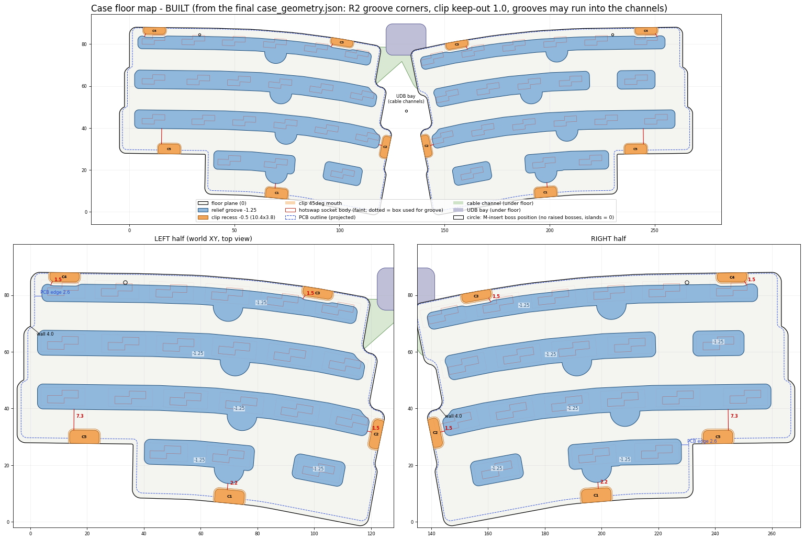

What changed in v3 (same look as v2):

- Pocket walls square to each half's PCB (v2's were vertical): one straight wall, floor to top, 0.9 mm from the PCB, the plate and every clip all round. No gap at the back.
- The PCB and plate share one edge (the outer edge of the two v1 outlines; the PCB grows up to 0.54 mm at the back and centre side). Key positions and spacing are unchanged.
- Two bottom panels: the v2-style one with the recessed underside, and a flat-bottomed one (back border kept).
- One TPU clip for all 10 spots (`tpu_clip`), replacing the FRONT / BACK pair. It prints on its flat outer face with no supports (45 deg end chamfers), and its lattice has flat-top cells whose hourglass struts flex under the PCB.
- Bezels, crease, rear cut, panel, USB step and bumpons as in v2. The case is 286.5 x 105.9 mm (1.8 mm wider: the centre web is 15.4 mm at the top, as the web-side walls lean in below it) and 39.1 mm tall.
- Machining: the pockets need one tilted setup per half (3+2) or 5-axis; printing is unchanged.

Print files for v3 are in [prints/v3/](prints/v3/) and for v2 in [prints/v2/](prints/v2/) (see [prints/README.md](prints/README.md)). The TPU clips are untested.

## Clone

```
git clone --recurse-submodules https://github.com/Noah-Mav/alice-case
# already cloned without it:
git submodule update --init
```

## Where to look

- [case/README.md](case/README.md): setup (venv), running the geometry and tests, Fusion build and export.
- [docs/fusion-case-plan.md](docs/fusion-case-plan.md): the case design plan.
